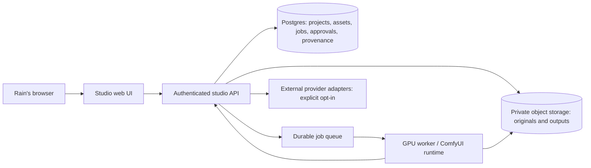

# Rain God’s Sad Boy Pipeline — product blueprint

**Status:** evidence-backed proposal, 20 October 2026
**Canonical codebase:** `POWDER-RANGER/RainGod-Comfy-Studio` (`main`, currently named in GitHub settings by its historical slug)
**Evidence snapshot:** current `main` at `2b989cfbe6e23085712901d5e3bf25e7ca8e1422`, merged PRs #38, #43, and #44, CI run #101, and local validation on 20 October 2026.

This is the working product blueprint and implementation order. It separates what the current code and CI prove from product direction and open verification work. A workflow template, adapter class, mock, README claim, or successful container build does not prove a provider can produce and return a real result.

## Product outcome

One cloud-hosted studio for Rain’s creative projects, with remote generation available. A project is the durable home for source material, notes, lyrics, recordings, audio analysis, generation jobs, outputs, revisions, and approvals. Rain remains the creative decision-maker. Automation can run only under rules Rain has explicitly set for the project and provider.

The first proving milestone is an image created by a real, configured ComfyUI-compatible GPU runtime, tracked to completion, displayed in the project, and saved with provenance. Project persistence and image generation should be built as one thin vertical slice; a disconnected image demo would not prove the unified product.

Music has two separate product paths, which must be verified independently:

1. **Work with existing music:** import or record a track, preserve the original, attach lyrics and notes, run an explicitly identified analysis, and save editable results.
2. **Create music:** generate lyrics/music/beats with an explicitly selected provider or local engine, keep revisions and source files, and capture the generation settings and provider record.

An audio import/analysis capability does not establish music generation, and a music-generation adapter does not establish support for imported recordings, lyrics, stems, or analysis.

## Evidence as of the snapshot

### Verified from the current repository and GitHub

- PR [#38](https://github.com/POWDER-RANGER/RainGod-Comfy-Studio/pull/38) established the single-master Sad Boy Pipeline direction and opt-in workflow deduplication. Run [#68](https://github.com/POWDER-RANGER/RainGod-Comfy-Studio/actions/runs/39530340500) failed at Ruff formatting; its Python 3.10/3.11 tests and Docker build passed, while lint and MyPy were skipped.
- Follow-up PRs [#43](https://github.com/POWDER-RANGER/RainGod-Comfy-Studio/pull/43) and [#44](https://github.com/POWDER-RANGER/RainGod-Comfy-Studio/pull/44) are now merged on current `main`. They fixed the formatter issue, lint/type-check issues, resource shutdown behavior, and added offline provider response tests.
- Current-main CI run [#101](https://github.com/POWDER-RANGER/RainGod-Comfy-Studio/actions/runs/39535898402) passed all four jobs: Ruff format/lint and MyPy, Python 3.10 tests, Python 3.11 tests, and Docker build. This closes the CI blocker from run #68 on `main`.
- The current code has a FastAPI studio entrypoint and image-generation routes backed by a ComfyUI client. That client defaults `deduplicate=False`; tests cover mocked request behavior. Job inspection reads ComfyUI queue/history and proxies returned image bytes. The included tests use a mocked ComfyUI client; they are API/client tests, not evidence of a live ComfyUI image.
- The dispatcher has local and cloud adapter routing, including Comfy Cloud and Suno adapter modules. Adapter construction is gated on environment variables. The modules’ presence does not prove keys, provider endpoints, billing, model/node compatibility, or generation outputs work.
- The current docs describe the product direction and artist-reference boundaries. Issue [#37](https://github.com/POWDER-RANGER/RainGod-Comfy-Studio/issues/37) remains open and lists completion gates.

### Not present or not verified

- No verified real image-generation result, remote-provider call, provider health check, or deployed studio was found in the evidence inspected for this blueprint.
- No durable unified project/catalog/asset database is present in the inspected backend. `outputs/` and ComfyUI history are filesystem/upstream job data, not a cross-provider project system or durable audit record. A ComfyUI `prompt_id` is not a studio-owned persistent job record.
- The current web app and dispatch endpoints contain no user authentication/authorization layer. Do not expose the present API as a public multi-user studio. API keys in environment variables are not a substitute for studio user authorization, rate limits, per-project access control, or spend controls.
- The current Comfy Cloud adapter is unverified. Its source targets `https://api.comfy.org/v1/runs` and Bearer-token auth. Current official Comfy Cloud user API documentation shows a cloud API host and `X-API-Key` auth for the documented user endpoint; reconcile the actual product API contract, allowed workflow types, output retrieval, credit model, and uploaded-asset rules before treating this adapter as usable. This discrepancy is a verification question, not a claim that an endpoint is definitively unavailable.
- The current Suno adapter is unverified; imported audio, lyric-file workflows, audio analysis, beat/stem analysis and exports are not established by that adapter.
- There is no evidence here about which models/custom nodes are installed on the ComfyUI fork, whether the fork is current, whether any `raingod_*` LoRA/checkpoint files exist, or their licensing/permissions.
- Historical repository content, deployments, Pages links, releases, and dependencies have not been audited. Do not delete or archive those repositories yet.

### Local validation of the current worktree (20 October 2026)

The current change adds a regression test ensuring a non-image file referenced by ComfyUI history is rejected before its bytes are fetched. The formatter, Ruff, and MyPy fixes are already present on `main` through PRs #43 and #44.

| Check | Result |
|---|---|
| `pytest tests/ -q` (Python 3.11, pinned development requirements) | **199 passed** |
| `ruff format --check backend/raingod_workflows.py` | **Fails on this Windows CRLF checkout; current-main Linux CI run #101 passed full backend formatting** |
| `ruff check backend/` | **Passed** |
| `mypy backend/ --ignore-missing-imports` | **Passed**, 20 source files |
| GitHub Actions run #101 on current `main` | **Passed** all lint/type, Python matrix, and Docker jobs |
| GitHub Actions run [#102](https://github.com/POWDER-RANGER/RainGod-Comfy-Studio/actions/runs/39536214550) on PR #45 | **Passed** formatter, lint, MyPy, Python 3.10/3.11 tests, and Docker |

The Windows checkout has CRLF working copies for many tracked Python files, while the GitHub runner checks LF files. Therefore the local formatter output is not comparable to Linux CI. CI run #102 confirms the full formatter check and other required jobs pass on PR #45. These tests use mocked ComfyUI responses and do not prove live image generation.

## Recommended architecture

Keep the interactive studio/API, durable state, media storage, and GPU generation as separate operational responsibilities:

- **Studio/API:** a modest CPU web service serves the UI and authenticated project API. It accepts requests quickly, returns a studio-owned job ID, and never waits inside a browser-facing request for a multi-minute generation.
- **Projects and job state:** Postgres stores projects, versioned project settings, asset metadata, job state/events, approval decisions, and provenance. A durable queue (Postgres-backed queue initially, or managed Redis/queue if job volume justifies it) lets jobs survive process restarts and supports retries/cancellation with explicit state transitions.
- **Media:** private object storage holds original user uploads and generated outputs. The database stores object keys, hashes, MIME/size, retention, project ownership, and provenance; use short-lived signed URLs or an authenticated download route. Never rely on a service’s temporary filesystem for project assets.
- **Generation:** one isolated GPU worker running a pinned ComfyUI build, approved custom nodes, and a controlled model manifest. The worker receives a validated workflow and scoped job data, writes results to private storage, then reports status/output metadata. The ComfyUI control port is private and never exposed directly to the public internet.
- **Provider boundary:** provider adapters advertise their tested capabilities, price/credit model, data sent, retention/terms, and supported asset types. A user selects or explicitly enables each provider. No automatic fallback may upload private source media to another provider without a policy that permits that exact transfer.

**Cloud path recommendation:** stage the studio/API and Postgres on Render, and run ComfyUI on an on-demand GPU platform (first evaluate Comfy Cloud against its documented API, then compare a pinned self-hosted ComfyUI worker on Modal or RunPod). Render’s current service plans describe CPU/RAM plans rather than a GPU worker offering, so it is a practical home for the studio control plane but not the GPU assumption. Avoid a GPU VM billed continuously during idle for the first proof. Modal publishes pay-per-second GPU rates and supports a workspace budget; its listed rates at research time work out to about $0.80/GPU-hour for L4, $1.10 for A10, and $1.95 for L40S, before CPU, RAM, storage, egress, image build/cold-start, and model-download costs. These are snapshots, not a quote; measure complete generation cost and cold start with the selected workflow before choosing. RunPod is a viable comparison candidate, but select it only after comparing availability, storage, cold starts, worker lifecycle, isolation, and all-in cost with the same workflow.

A single ComfyUI server can simplify the first proof, but persistent models and large VRAM needs make always-on GPU hosting expensive. For the first staging proof, start one worker on demand, pin one small approved model/workflow, cap concurrency at one, stop it after an idle window, and set a hard provider/account budget. If cloud-provider GPU startup is too slow or its workflow/model contract does not fit, use a dedicated GPU pod with explicit auto-shutdown as a temporary staging fallback. Do not move the public API or user uploads into the GPU container.

### Deployment stages

1. **Local/offline development:** tests, workflow schema checks, fake provider boundaries labeled as mocks, and UI work; no spend or claims of real generation.
2. **Private staging control plane:** Render PR preview or a private staging service plus an isolated staging Postgres database. Use synthetic/sample project data only, separate credentials from production, enable authentication before any public access, and check preview environment variables so it cannot inherit production database/provider secrets. Render previews are temporary and billed by the selected plan; remove them when the review is complete.
3. **Capped real-generation staging:** connect only an isolated GPU runtime and a provider key with a low spending ceiling; use one reviewed text-to-image workflow and a non-sensitive test project. Record actual wall time, GPU-seconds, startup/download time, output size, cost, failures, and provenance. Verify health/configuration → fresh job → status transitions → actual output bytes/display → persisted project asset → restart/recovery.
4. **Production readiness gate:** require passing CI (format, lint, type-check, Python matrix, Docker), auth/access-control/security review, backup/restore rehearsal, cost limits, upload/output validation, successful staging end-to-end evidence, and a written capability/provider matrix. No automatic production rollout as part of this plan.

Render service previews copy service settings, including environment variables, when initialized, so staging must explicitly override production URLs/secrets. Render filesystems are ephemeral unless a paid persistent disk is attached; attached disks are single-instance and prevent zero-downtime deploys. Use Postgres and object storage for the shared project system rather than coupling project media to the web service’s local disk.

## Approval, security, provenance, and cost boundaries

- Keep global project ownership and final creative decisions with Rain. The initial deployment can be single-user; implement authorization even before multi-user collaboration exists.
- Provide named approval modes per project/provider/action: **ask every time**, **allow within this project’s saved limits**, and **disabled**. Store the policy version and the user’s decision with each job. Never silently widen permissions after changing provider, model, workflow, input asset, or external data destination.
- Require an explicit approval when a workflow would send source audio, lyrics, reference images, or project metadata to a new external service; when it spends beyond saved limits; and before publishing, sharing, training, deleting originals, or performing an irreversible action. Automatic production may run only within user-defined approved recipes, project scope, provider scope, model/workflow allowlists, and budget ceilings.
- Enforce server-side per-job, daily, and monthly spend/credit ceilings, queue/concurrency limits, output-size/storage quotas, max duration, timeout, and cancel behavior. Show estimated or unknown cost before run; stop if estimate cannot be bounded under the saved policy. Add budget alerts and a hard stop. Provider free credits/quotas are volatile and must never be hard-coded as guaranteed.
- Require auth, CSRF protections for browser sessions, rate limits, least-privilege secrets, private GPU networking, upload MIME/size and image/audio validation, safe filenames/object keys, output access checks, and redacted logs. Keep API keys out of browser code, job payloads, prompts, logs, and artifacts.
- Record input asset IDs and hashes, source/rights notes, project/profile version, prompt and workflow version, provider/model/checkpoint/custom-node manifest, seed/settings, approval policy and decision, studio job/provider run IDs, timestamps, status/errors, output hashes/object keys, cost/credits, retries, and any external transfer. Keep originals immutable; edits/analysis/generated outputs are separate versioned assets.

## Prioritized implementation plan

| Priority | Deliverable | Acceptance evidence |
|---|---|---|
| **P0 — unblock trusted iteration** | Resolved on `main` by PRs #43 and #44. | Current-main CI run #101 passed formatting, lint, MyPy, Python 3.10/3.11 tests, and Docker. A fresh PR run is still required for changes proposed after that baseline. |
| **P0 — image vertical slice inside a project** | Add the smallest durable project, asset, approval, job, and provenance records needed to create a project and save a real ComfyUI image into it. Use a durable job state machine and object storage. | In private staging, a fresh real GPU job reaches success, a genuine output is persisted/displayed after API restart, and a reviewer can inspect reproducible settings and provenance. Capture exact workflow/model/node requirements and cost. |
| **P0 — safe staging boundary** | Add authentication/authorization, private networking, scoped provider secrets, upload/output controls, per-project/job limits, kill switch, and preview/staging secret isolation before public cloud use. | Security-focused checks and staging configuration review show unauthenticated access is blocked and staging cannot access production data/credentials or exceed configured budget. |
| **P1 — project workspace quality** | Build project/library UI, immutable originals, versioned editable visual profiles, asset links, search, compare/pin/reject, export/backup, and job recovery after restart. | A project can be exported/restored with source/derived assets and provenance intact; Rain’s edits/approval remain visible and reversible. |
| **P1 — existing-music path** | Import recordings and lyrics, store originals, attach metadata, run one selected audio analysis with tool/version/provenance, and present editable results. | A known test track and lyric file round-trip without loss; analysis runs are reproducible and clearly separate observation from interpretation. |
| **P1 — generated-music path** | Audit each provider’s current official API/terms; implement one licensed, verified generator behind the provider contract. Keep lyrics, music, instrumental/beat creation and any stems as distinct capabilities. | Provider test with configured credentials returns a real audio asset; cost, rights/terms, retention/data transfer, errors, cancellation, outputs, and provenance are documented. Test separately from the import/analysis path. |
| **P2 — controlled expansion** | Add more models/providers, local/cloud routing, video synchronization, batch workflows, and cross-modal automation only where the same project/approval/provenance model applies. | Each provider/feature has its own real positive and failure evidence, cost ceiling, and capability entry; no mock or adapter declaration appears as live. |
| **Release gate** | Review legacy repos for unique code, issues, releases, Pages/deployments, links, and dependencies; port only useful tested work. | A migration map and link/deployment checks exist before any repository archive/delete action. Then decide whether to rename the master repo slug. |

## Immediate next actions

1. Review PR #45, whose CI is green, then proceed with the project-backed image job and persistence slice.
2. Use the next implementation PR to add the smallest project-backed image job record and persistence design, with provider contract tests that remain clearly mocked; defer the real GPU test until private staging controls and a capped GPU account are in place.
3. Reconcile `README.md` and `docs/ARCHITECTURE.md` with the actual tree and status, including duplicate modules under `files/`, current endpoint/auth behavior, job persistence limits, and unverified adapter claims.
4. Run the staged end-to-end image proof, then separately schedule discovery and implementation for each music workflow.

## Technical references consulted

- [Render service types](https://render.com/docs/service-types), [persistent disks and their limits](https://render.com/docs/disks), and [service previews](https://render.com/docs/service-previews).
- [Modal GPU pricing](https://modal.com/pricing) and [GPU documentation](https://modal.com/docs/guide/gpu); prices/availability can change.
- [ComfyUI Cloud user API reference](https://docs.comfy.org/zh-cn/api-reference/cloud/user/get-current-user-information) and [ComfyUI Partner Nodes/data/cost guidance](https://docs.comfy.org/tutorials/partner-nodes/overview). This proves documented account/partner-node behavior only, not the current studio adapter’s `/runs` call.
- [Official ComfyUI Stable Audio workflow guide](https://docs.comfy.org/tutorials/api-nodes/stability-ai/stable-audio) shows both text-to-audio and audio-to-audio/inpainting workflows exist in ComfyUI’s documented ecosystem. It does not establish that this repository has a working integration or that a particular Comfy Cloud plan supports them.
